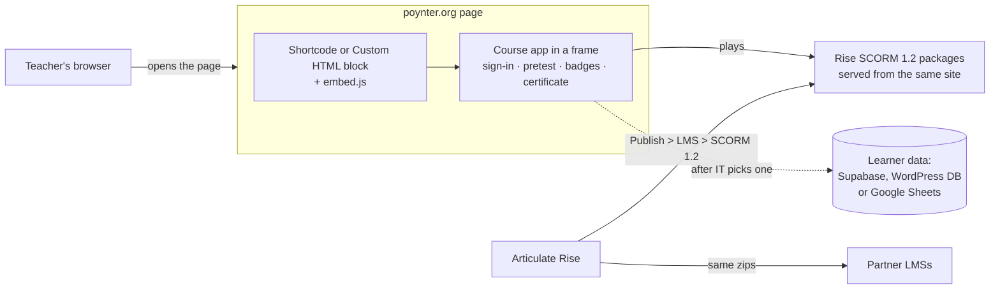

# How the course app works

Courses are written in Articulate Rise and exported as **SCORM 1.2** packages. A small JavaScript app plays those
packages on a poynter.org page and handles everything Rise can't do on its own: sign-in, a pretest and posttest,
a badge per course, PD hours and a certificate. Learner data goes in a database once IT picks one.

## The pieces

| Piece | What it is | Where it is in this repo |
| --- | --- | --- |
| Course app | One HTML page with inline JavaScript and CSS. No build step, no framework. | `index.html`, `brand/`, `lib/` |
| SCORM player | [scorm-again](https://github.com/jcputney/scorm-again) (open source, MIT), bundled locally. It acts as the LMS for each Rise course. | `lib/scorm12.min.js` |
| Sample course | A one-lesson Rise SCORM 1.2 export, used for any course that hasn't been uploaded yet | `courses/sample/` |
| WordPress plugin | Serves the app from the plugin folder, adds the `[mediawise_course]` shortcode, and gives admins an uploader for each course's Rise zip | `plugin/` |
| Page script (`embed.js`) | Sizes the frame to the app, keeps it under the sticky site header, locks page scrolling while a course is open | `plugin/mediawise-course-app/assets/embed.js`; no-plugin version in `embed/` |
| Database design | Supabase tables, access rules, sign-in function, staff report | `database/` |
| Course source | The spec and scripts that build courses in Rise | `rise-build/` |

## What happens when a teacher uses it

1. **Sign-in:** name and email. No password, no verification email. The same email on another device picks up their progress (once a database is connected).
2. **Pretest:** short, ungraded, before the first course.
3. **A course opens:** the app loads that course's Rise package in a frame inside its own frame and gives it the SCORM API. The page locks scrolling and lines the course up under the site header.
4. **Rise reports progress:** status, location, time and resume data go through SCORM to the app, which saves them.
5. **Badge:** when Rise reports `passed` (or `completed`), the app awards the course's badge and 30 minutes of PD time.
6. **Posttest and certificate:** after Start Here, Evaluating and Detecting, Take It to Your Classroom and at least one subject course.

## Two ways to host it

| | Plugin | Folder + embed |
| --- | --- | --- |
| App files | `wp-content/plugins/mediawise-course-app/app/` | A folder or subdomain on poynter.org |
| Course files | `wp-content/uploads/mediawise-courses/<id>/`, uploaded in WP admin | Uploaded by SFTP into the folder |
| On the page | `[mediawise_course]` | The code in `embed/embed-code.html` in a Custom HTML block |
| Learner data options | All three | Supabase or Google Sheets |
| IT maintains | Our plugin code | A folder of static files |

Both keep the app and course files on the same domain, which SCORM tracking needs. The demo on the WordPress dev
site uses the folder route, with the files on GitHub Pages for now.

## Things learned the hard way (all handled in the code)

- **Stale resume data.** If a course is re-exported, a learner's saved place can point at a lesson that no longer exists,
  and Rise shows "We can't seem to find the page." The app tags saved progress with Rise's `coursePackageVersion` and drops
  it when the version changes. Badges are kept.
- **Hosts that inject frames.** Rise's launcher starts the course only when every frame on its page has reported loaded.
  Netlify's toolbar (and some WordPress plugins) add a frame, so the course never started, or started twice and showed
  "Error initializing communications with LMS." The app now allows one start and starts the course itself if it stalls.
- **WordPress rewrites scripts in post content.** `&&` became `&#038;&#038;`. The embed script is written without `&` or `<`.
- **The Poynter theme rebuilds the page after load,** so the embed script looks up the frame each time instead of keeping a reference.
- **Block themes override CSS full-width tricks.** The plugin's script measures the page and sets the width directly.

## Security notes

- Course zips are checked on upload: they must contain `scormdriver/indexAPI.html`. Anything that isn't a static file type a
  Rise export uses (PHP, `.htaccess`, scripts, links) is deleted, and an `.htaccess` in the upload folder blocks script execution on Apache.
- The uploader is admin-only (`manage_options`) and uses WordPress nonces.
- The app accepts a course location only as a same-site path.
- Page and app talk with `postMessage`; the page script accepts messages only from the app's own frame and origin.
- No passwords. With a database, each learner reaches only their own rows (row-level security). See `database/README.md`.
